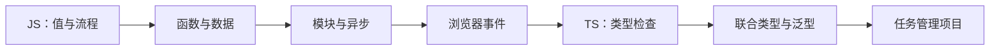

# 从 JavaScript 到 TypeScript：边改边学

一套中文动手课程：82 道就地小练习 + 19 个综合大练习。每段讲解下面直接练一下，做完进入下一段，最后独立完成本关的完整任务。支持 Windows、macOS 和 Linux，使用 Node.js 24 或更高版本。

## 下载与首次启动

在 GitHub 仓库点击 **Code → Download ZIP** 后完整解压，或使用 Git：

```sh
git clone https://github.com/heeeex100/javascript-to-typescript-lessons.git
cd javascript-to-typescript-lessons
npm run workshop
```

打开终端显示的本机地址，从 00 关开始。JS 网页课程无需安装 npm 依赖；学到 TS 时运行 `npm ci`。Windows 可直接双击 `start-workshop.cmd`，或在 PowerShell 使用 `npm.cmd` 执行同样的命令。停止服务按 Ctrl+C。

在 Windows 学习：[迁移、安装与启动步骤](Windows使用说明.md)。解压后可双击 `start-workshop.cmd` 启动实验台。

**已经掌握基础？进入 [6 个进阶挑战（13～18）](challenges/README.md)**：做搜索分页、撤销重做、请求竞态、并发任务池、脏数据校验和类型安全事件通知器。实验台新增“进阶”入口。

**讲一段，就练一下。** 每页讲解与对应小题放在一起，使用“继续下一段讲解”前进；最后一题的按钮进入“综合大练习”。大题默认显示任务要求和输入输出，解题思路、完整答案、加分需求都折叠起来。

## 如果之前看不懂，从这里重新试

先进入 **第 02 关**。不要立刻修完整循环，先看 `total = total + 3` 怎样把总数从 0 改成 3，再加 5 怎样得到 8。第二步有逐次变化表；第三步对比“把 total=0 放进循环，每次都会清零”的错误版本。

第 02 关有 11 段，从“加一次”逐步到循环、严格比较、并且/或者/取反和默认值。第 03 关有 10 段，先练函数返回值，再练回调、作用域、默认参数与独立计数。第 04、05 关各有 8 段，补上对象复制、跨文件模块和实际调试；其余关各三段。每段都配对应小题，最后完成完整任务。

这轮按 MDN 对照优先补基础衔接，新增 22 道小题。第 03 关综合题要创建可接收计算规则、各自记录订单数的工具；第 04 关要重命名并生成摘要，同时保留原数据；第 05 关要在两个文件间实现任务存档。字符串专项、Map/Set、类与 this、日期正则及真实网络请求尚待后续扩展，当前不是 MDN 全量课程。

基础综合题在 `practice/finals/`，完整参考在 `answers/finals/`。第 03、04、05 关改用新文件，旧版综合题仍保留；打开新文件路径以当前关卡说明为准。原来的 `practice/00.js` 等文件保留；网页已有自定义草稿也保留，想从新综合题脚手架开始时，可先下载旧草稿，再点“加载大练习起点”。

普通 JS 小题可以直接在网页编辑；模块小题 05-04、05-05、断点小题 05-08 和 TS 小题在本地完成。先准备文件，再运行检查：

```sh
npm run drill -- 08-01 --prepare
# 编辑 practice/steps/08-01.ts，保存后：
npm run drill -- 08-01 --check
```

小题文件与原练习独立，重复准备不会覆盖修改。网页小题草稿单独保存在此浏览器，当前主挑战的导出备份不包含它们；如需迁移，请复制代码到本地文件。本地 `practice/steps/` 不提交 Git、不进入课程包。模块小题的 prepare 会同时创建入口和配套文件，重复执行保留每份文件的修改。第 05 关综合题在 `practice/finals/05-storage/` 本地编辑：`storage.js` 写工具，`main.js` 导入使用，然后执行 `npm run lab -- 05 --check`。这些本地文件也需要单独备份。

想先建立知识地图，打开 [概念导航](reference/概念导航.md)：从程序与运行环境、变量和表达式，逐步到函数、对象引用、异步、TS 类型与泛型，再进入进阶挑战的闭包、竞态、并发和事件类型。

遇到“这个符号为什么这样写”，可查 [基础语法检查与说明位置](reference/基础语法检查.md)，它列出了 19 关的语法说明和参考资料。

## 现在就动手：完成时长计算面板

1. 打开 [动手实验台](workshop/index.html)，选择第 **01** 关。也可以从 00 开始做学习卡。
2. 每读一段，就在它下方做对应小题；一共三段。
3. 最后进入综合大练习，自己完成文字转数字、加奖励分钟和 valid 判断。
4. 点击“验收综合大练习”，然后把输入改成“0”“30”“abc”再试。
5. 用自己的话解释：修改前拿到的是什么值，修改后拿到的是什么值，哪一行让它改变。最后再看相关名称。

如果直接打开页面被浏览器限制，在本目录的终端运行：

```sh
npm run workshop
```

打开终端给出的本机地址。页面运行和保存草稿均不需要外部网络。退出预览服务时在该终端按 Ctrl+C。

## 保存进度、换电脑与查看指导

- 展开左侧 **备份与迁移**，导出一个 JSON 备份，包含网页 JS 草稿与对应的验收记录；另一台电脑打开新版实验台后导入。
- 导入前会显示新增、相同、冲突的关数。默认保留本机冲突草稿；只有明确勾选才替换。不会写入或覆盖 `practice/` 文件。
- **下载代码** 可把当前网页草稿保存成 `.js` 文件，再手动放到 `practice/`，衔接终端练习。
- **打开完整动手指导** 会在实验台内排版显示正文、表格、代码和折叠提示；无需离开当前代码页。
- 代码框显示行号；可以主动停止运行。`Ctrl / ⌘ + Enter` 运行，`Ctrl / ⌘ + Shift + Enter` 检查。上/下一关和浏览器返回可用于切换，重新打开时会记住上次关卡。

备份仅覆盖网页 JS 练习。TS / DOM 的本地文件请另外复制保存；旧版只有 true/false 的通关记录会提示重验，草稿保持原样。新版记录会绑定实际代码和验收内容，修改代码或课程验收变化后需重新检查。

**网页草稿与本地文件是两份独立练习。** 网页草稿保存在当前浏览器；`npm run lab` 读取 `practice/` 中的本地文件。网页修改不会自动写入项目；需要保留到文件时复制代码到对应的 practice 文件。

JS 00～06 关可直接在网页编辑运行。07 关修改真实页面、保存后刷新。08～12 关编辑本地 `.ts` 文件，用真实编译器检查，不在网页里模拟类型报错。

## 每关固定的体验

**看一个例子 → 逐行追踪 → 改一个值 → 检查一个小步骤 → 换输入 → 再组合成主挑战。**

讲解区每次进入一关都会从第一段开始，完整讲义按同样顺序交错排放讲解和小题，最后列出综合题。原例仍可独立运行，用下面三个命令完成“先看 → 再改 → 再运行”：

```sh
npm run concept -- 08
npm run concept -- 08 --prepare
npm run concept -- 08 --local
```

第一条会真实编译并运行概念原例（TS 先 `npm ci`）；第二条创建 `practice/concepts/08.ts`，在编辑器修改该文件后，再运行第三条。重复 `--prepare` 会保留已有修改。JS 用法相同，文件为 `.mjs`；07 创建 `.html` 后用浏览器打开。所有实验与挑战文件、网页草稿独立，`practice/concepts/` 不会提交到 Git 或打进课程包。

起始代码故意留了问题，第一次失败是预期现象。检查通过只代表基础要求满足；再做“自己的版本”，才把知识用到自己的想法里。每关约 15～30 分钟，不要求一次做完。

## 学习路线

| 关卡 | 你要做出来的东西 | 在过程中认识 |
| --- | --- | --- |
| [00](lessons/00-开始之前.md) | 给自己做一张学习卡 | 变量、字符串、输出 |
| [01](lessons/01-变量和值.md) | 修好学习时长计算器 | 字符串转换、数字计算 |
| [02](lessons/02-条件和循环.md) | 找出漏掉的专注记录 | 条件、循环、边界 |
| [03](lessons/03-函数和作用域.md) | 创建会记订单数的结账工具 | 函数、回调、作用域与闭包 |
| [04](lessons/04-数组和对象.md) | 重命名任务并生成摘要 | 数组、对象复制、filter / map |
| [05](lessons/05-模块和错误.md) | 跨文件读写任务存档 | 模块、JSON、异常与断点调试 |
| [06](lessons/06-异步编程.md) | 等到外卖到了再拆袋 | Promise、await、失败处理 |
| [07](lessons/07-浏览器和DOM.md) | 让页面显示剩余任务数 | DOM、事件、重新渲染 |
| [08](lessons/08-进入TypeScript.md) | 让编译器拦住错误的加法 | 编译与静态类型检查 |
| [09](lessons/09-对象类型和接口.md) | 处理没有备注的任务卡 | 可选属性、空值默认值 |
| [10](lessons/10-联合类型和收窄.md) | 拒绝乱填的任务标题 | unknown、收窄、联合类型 |
| [11](lessons/11-泛型.md) | 让工具记住拿到的类型 | 泛型、类型关系、空数组 |
| [12](lessons/12-综合项目.md) | 删除任务但保留上一份列表 | 不可变更新、失败结果 |



建议每课分两次学，每次约 30～45 分钟；这是节奏参考，不是期限。第 01～06 课的 Node 练习不依赖浏览器，第 07 课单独体验浏览器，第 08 课再开始使用编译器。

## 怎么使用这些文件

- `lessons/`：动手主线，每关包含概念入门、小实验、自测和挑战步骤。
- `workshop/`：浏览器动手实验台，00～06 可编辑并运行真实 JS。
- `practice/`：每关独立的起始练习，供本地编辑；07-dom 是实际网页。
- `practice/finals/`：基础关新的综合大练习脚手架；07-dom 需要实际浏览器操作。
- `reference/`：原来的概念讲解，遇到问题时按需查阅。
- `reference/foundations/`：19 关新增概念原稿；维护时运行 `npm run sync:concepts` 同步网页和讲义，`npm run check:concepts` 检查是否一致。
- `answers/practice/`：本次动手关卡的参考解法，先试再看。
- `examples/js/`：可以直接运行的 JavaScript 示例。
- `examples/browser/`：双击 HTML 即可体验的浏览器示例。
- `examples/ts/`：TypeScript 示例，经编译后运行。
- `project/`：最后一课的完整参考项目。
- `exercises/`：留给你修改的练习文件，初始状态故意未完成。
- `answers/`：练习参考实现和逐课思路，做完再看。
- `checks/`：示例及练习的行为检查；不要求初学时理解检查代码。

所有命令都在本目录执行：

```sh
cd javascript-to-typescript-lessons
node examples/js/01-values.js
```

学到第 08 课时，若没有 `node_modules`，先运行 `npm ci` 安装锁定版本的编译器。无需全局安装 TypeScript。

| 命令 | 用途 |
| --- | --- |
| `npm run workshop` | 启动本机实验台，打开终端显示的网址 |
| `npm run concept -- 08` | 编译并运行概念小例子 |
| `npm run concept -- 08 --prepare` | 创建可修改的独立小实验，不覆盖已有文件 |
| `npm run concept -- 08 --local` | 运行修改后的独立小实验 |
| `npm run verify:concepts` | 核对 18 个命令行概念例子的真实输出 |
| `npm run lab -- 01` | 运行本地第 01 关 |
| `npm run lab -- 01 --check` | 检查本地第 01 关 |
| `npm run drill -- 02-01 --prepare` | 创建某一道小题，不覆盖已有文件 |
| `npm run drill -- 02-01 --check` | 检查这道小题的本地代码 |
| `npm run verify:drills` | 核对全部 82 道小题的起点和参考写法 |
| `npm run verify:labs` | 验证全部可执行关卡的起始问题和参考解法，不修改你的练习 |
| `npm run verify:advanced` | 只验证进阶题的起始问题和参考答案 |
| `npm run test:workshop` | 检查备份合并、运行反馈、命令行验收和课程文件服务 |
| `npm run check` | 检查 TS 类型，不生成 JS |
| `npm run build` | 编译 TS 到 `dist/` |
| `node dist/examples/ts/08-basics.js` | 运行编译后的第 08 课 |
| `npm run demo` | 编译并运行综合项目 |
| `npm run verify` | 验证参考示例和答案，不要求你的练习已完成 |
| `npm run exercise:js` | 检查你的 JS 练习，最初失败是预期现象 |
| `npm run exercise:ts` | 编译并检查你的 TS 练习，最初失败是预期现象 |

## 每课的学习方法

1. 先用自己的话说明“这段代码接收什么、返回什么”。
2. 不运行，先写下你预计看到的输出。
3. 运行示例，对比差异，定位到具体一行。
4. 改一个值或一个条件，观察行为如何变化。
5. 合上示例做练习，最后才读答案。

阶段验收：第 04 课后，能独立筛选任务；第 06 课后，能解释等待和异常；第 10 课后，能解释为什么接口返回的数据仍要校验；第 12 课后，能增加一个带检查的任务操作。

## 资料与范围

教学内容为本地编写的渐进示例。基础概念可交叉查阅 [MDN JavaScript 学习模块](https://developer.mozilla.org/en-US/docs/Learn_web_development/Core/Scripting)、[TypeScript 入门说明](https://www.typescriptlang.org/docs/handbook/typescript-from-scratch.html) 和 [TypeScript 类型收窄](https://www.typescriptlang.org/docs/handbook/2/narrowing.html)。另参考 [MDN 中文 JavaScript 指南](https://developer.mozilla.org/zh-CN/docs/Web/JavaScript/Guide) 的主题结构，于 2026-10-20 对照当前课程。示例与练习为本课程原创组织。

本教程先建立语言和运行机制基础。React、Vue、装饰器、构建工具生态以及复杂条件类型留到后续；无需在开始阶段同时学习。

维护者可运行 `python3 scripts/package-windows.py` 重新生成 `exports/typescript-windows-latest.zip` 和校验值。该命令只收集课程目录，排除依赖和临时文件；学习者运行课程不需要 Python。

维护流程见 [CONTRIBUTING.md](CONTRIBUTING.md)。GitHub Actions 会在 Windows/Linux、Node.js 24/26 上检查概念、示例、工具、主挑战及 82 道小题；浏览器 DOM 操作另行检查。

## 常见问题

- **npm / node 找不到**：先安装 Node.js，再重新打开终端。Windows PowerShell 若阻止 npm.ps1，可改用 `npm.cmd`。
- **端口 8766 已占用**：先看是否已启动一个实验台；可使用该窗口，或关闭旧服务后重启。
- **TS 提示缺少编译器**：在有 package.json 的项目根目录执行 `npm ci`；不要从另一种操作系统复制 node_modules。
- **第一次检查失败**：practice 和 exercises 是故意留问题的练习。`npm run verify:labs` 用内置起点与参考答案验证课程本身，不要求你先完成练习。
- **网页修改没出现在终端**：网页草稿与本地文件独立。下载网页代码后手动保存到对应 practice 文件，或始终选一种方式练习。
