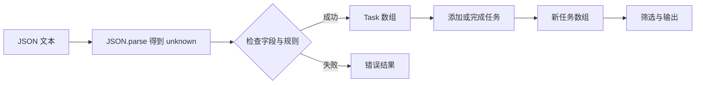

# 12 · 综合项目：任务数据的完整生命周期

目标：综合 JS 的数据操作与 TS 的类型建模，运行一个有正常路径和失败路径的任务管理程序。

```sh
npm run demo
```

程序从内嵌 JSON 加载初始任务，创建任务，完成指定任务，列出待办，再演示非法输入。数据只保存在进程内存中，重跑会恢复初始值。这一课专注数据与类型；第 07 课的浏览器版是单独的 DOM 练习。

## 1. 文件各自负责什么

| 文件 | 职责 | 建议阅读顺序 |
| --- | --- | --- |
| `project/models.ts` | Task、Result 的类型约定 | 1 |
| `project/validation.ts` | unknown / JSON 到可信 Task[] | 2 |
| `project/service.ts` | 添加、完成、筛选 | 3 |
| `project/main.ts` | 串起流程、打印结果 | 4 |



函数之间通过参数和返回值连接，没有全局可变任务库。service 返回新数组，调用方显式接收后继续使用。

## 2. 跟踪一次添加操作

在 main 中找到 `addTask(tasks, "练习联合类型")`。输入 tasks 已经通过校验，因此 service 可以按 readonly Task[] 使用。标题仍来自普通字符串，需要 trim 并检查非空。

service 用当前最大 id + 1 创建 id，并检查是否仍为安全整数。这适合当前内存练习，不是多用户系统的并发 ID 方案。

成功返回 `{ ok: true, value: 新数组 }`；失败返回 `{ ok: false, error: 原因 }`。main 判断 ok 后才能读相应字段。

## 3. 做三次有目的的修改

1. 把输入 JSON 的一个 done 改为 `"false"`，重新运行。应在数据校验阶段失败，不进入任务操作。
2. 给 addTask 传入空格。应返回失败，原数组不受影响。
3. 用不存在的 id 调用 completeTask。项目版会明确返回失败；第 04 课基础练习选择保持内容不变，两者是不同的业务约定。

每次只改一项，观察结果，恢复后再做下一项。遇到编译错误先修复源码，不要运行旧 dist 来判断新代码的行为。

## 4. 自己增加删除功能

在 service 中实现：

```ts
export function removeTask(tasks: readonly Task[], id: number): Result<Task[]> {
  // 先检查是否存在，再使用 filter 返回新数组
}
```

验收标准：存在时删除对应项；不存在时失败；不修改原数组；删除后其他任务顺序不变。再在 main 中调用并处理成功与失败。参考实现见答案，但建议先自己完成。

## 5. 项目检查

`npm run verify` 会执行类型检查所需的构建、运行 JS / TS 示例，并验证校验边界、添加、完成、输入不变等行为。检查通过只说明覆盖的行为符合当前约定，不代表项目已经具备数据库、网络服务或生产应用能力。

## 最终验收

合上教程，解释以下问题：

- JS 的哪些部分仍然直接保留在 TS 中？
- 为什么合法 JSON 也可能被拒绝？
- 为什么不能把所有外部输入直接写成 `as Task[]`？
- service 为什么返回新数组，main 为什么需要接收它？
- 什么时候泛型比直接写 Task 更合适？

完成后可选方向：想做页面，继续学浏览器模块与组件；想做服务，继续学 Node HTTP 与数据库；想阅读现有 TS 工程，先练习从 package.json 脚本、入口文件、类型定义追踪一条真实调用链。
